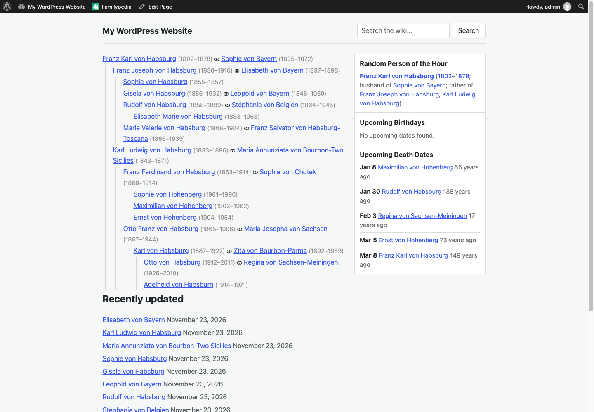
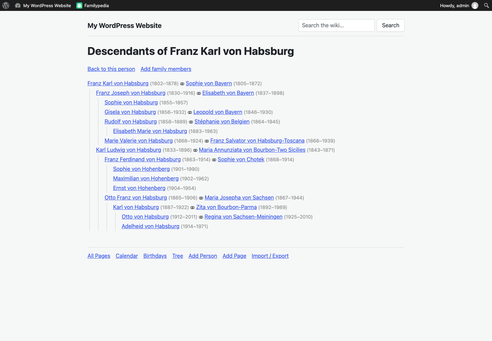
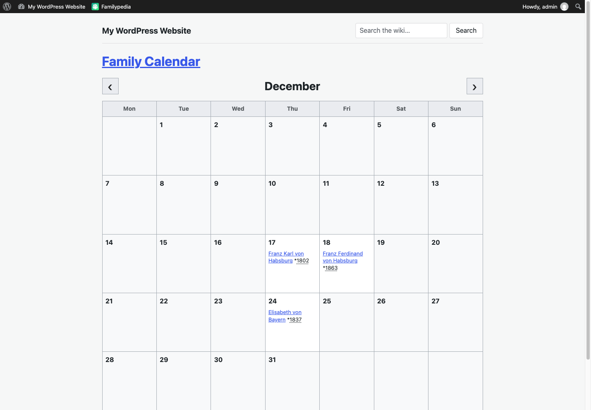
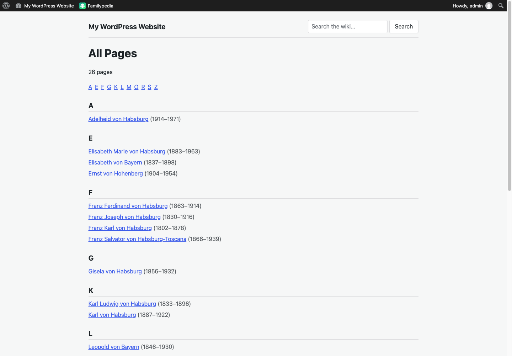

# Familypedia — Your private family wiki

- Contributors: akirk
- Tags: family, wiki, genealogy, wpapps
- Requires at least: 6.0
- Requires PHP: 7.4
- Tested up to: 7.1
- License: GPL-2.0-or-later
- License URI: https://www.gnu.org/licenses/gpl-2.0.html
- Stable tag: 2.0.0

Like Wikipedia, but private and just for your family. Give every relative a page, connect the family tree, and keep the stories, photos and voices that make those names meaningful.

## Description

Who is in that old photograph? How did your grandparents meet? What do you remember about the last family reunion? Familypedia gives your family a shared place to collect the answers on your own WordPress site. Start with a few people and memories, or bring an existing family tree through GEDCOM and build on it together.

[Try Familypedia with the historical Habsburg family in WordPress Playground](https://playground.wordpress.net/?blueprint-url=https://raw.githubusercontent.com/akirk/family-wiki/main/demo.json).

### A family history you can explore and grow together

- **Put stories beside the facts.** Give each person a biography, portrait and structured family facts. Add related pages for the memories and stories that deserve more room.
- **See how everyone connects.** Follow relationships between relatives and explore descendant trees to put names and generations in context.
- **Keep family occasions close.** Browse birthdays and wedding anniversaries in the calendar, and collect reunions and visits alongside the people who took part.
- **Capture memories while you can.** Guided interviews offer questions and follow-ups, saved notes and audio recording. Turn selected interviews into an attributed biography outline, then review it before adding it to a person's story.
- **Build on research you already have.** Import and export GEDCOM to exchange family-tree data with other genealogy tools. A separate content export/import carries biographies and related pages along with people.
- **Contribute as a family.** Give relatives WordPress accounts so they can add people, upload photos and improve each other's pages.

### At home on your WordPress site

Familypedia is a [WP App](https://wpapps.kirk.at/): an app that runs on your own WordPress site, with its own interface for people, trees, interviews and calendars. Open it at `/familypedia/` and use your WordPress account to sign in.

It can live alongside your existing website. Keep your public homepage, blog or business site while your family wiki stays private: only signed-in users with wiki access can open its pages. The app's interface is independent of your site's theme.

A dedicated WordPress site for your family makes sense too. Give your family archive its own address, invite relatives to contribute, and optionally make the wiki the homepage for signed-in members. The wiki still requires an authorized account to access it.

### Get started

1. Install and activate Familypedia on a WordPress site running WordPress 6.0 or later and PHP 7.4 or later. For a GitHub installation, use the [`dist/main` branch](https://github.com/akirk/family-wiki/tree/dist/main), which includes the required dependencies. Source checkouts need `composer install --no-dev` first.
2. Sign in as an Administrator and open `/familypedia/` on your site.
3. Choose **Add Person** to start with someone you know, or use **Import / Export** to bring in a GEDCOM family tree.
4. Invite family contributors with WordPress Editor accounts, then add stories, photos and interviews together.

Wiki access is restricted to users with the Editor role or above.

You can optionally make the wiki the homepage for signed-in family members in **Settings → Familypedia**.

### Bring your family history to life

Start with what you know: add a relative, write down a memory, upload a photo and connect the people in it. Each contribution gives the next person something to build on. Your family wiki can grow a little at a time as relatives add their own stories and fill in the gaps.

Talking to family members is a useful way to discover what to add. Ask about a childhood home, a familiar tradition or the story behind an old photograph. Familypedia's interview feature helps you capture those conversations with suggested questions, written notes and audio recordings. You can return to them later and turn the memories into a biography, keeping the original interview as a source.

### Build on each other's research

If a relative is researching your family in another genealogy app, ask them to share a GEDCOM file. Familypedia can compare it with your family record, helping you spot missing dates and other details they have uncovered. Review the differences and choose which facts to bring into your wiki, filling gaps while keeping control over what changes.

You can also export your own family tree as GEDCOM to share your discoveries with them, so your research can grow together even when you use different tools.

### Back up your family archive

Include your WordPress database and uploads directory in your backups to preserve your family records, photos and recordings.

### Upgrading from Family Wiki 1.x

Familypedia no longer requires Advanced Custom Fields (ACF). The migration carries over your existing family facts and retains the original ACF metadata.

Back up your database, then open Tools → Upgrade Familypedia. Review and select your people and related pages. Pages with family facts are selected initially; include relatives and child pages together. Migration validates these dependencies before moving any posts.

Selected pages become app posts with the same IDs, content, featured images and hierarchy. Relationship IDs remain intact, ACF dates are normalized, settings are copied, and old person URLs redirect to the app. The original homepage remains a WordPress page; its content is also copied into the app homepage. Unselected ordinary site pages stay in WordPress. The migration can be run again for remaining pages.

Existing bio shortcodes and Family Wiki tree/calendar blocks continue to work. Converting posts back to ordinary pages is not an automatic downgrade path; restore your backup to revert the migration.

### Development

Development happens on `main`. Dependencies in `vendor/` are ignored by Git; run `composer install --no-dev` before using a source checkout. For development checks, run `composer install` followed by `composer test`. The migration tests use an in-memory fixture and do not connect to WordPress or its database.

Every push to a source branch builds an installable `dist/<branch>` branch with production dependencies and appends the source commit to the plugin version. The build can also be run manually for a source branch from GitHub Actions. Use `dist/main` for installations and WordPress Playground; PR previews use their corresponding distribution branches and become available once the build finishes.

`demo.json` installs the app, signs in and imports the historical family from `demo/demo.ged`, adds the biography in `demo/demo-content.xml`, and places a descendant tree on the homepage. The seed data ships with the plugin so the gallery demo can also load it from a WordPress.org installation. The development-only generator can refresh the GEDCOM from Wikidata with `php demo/generate-demo-gedcom.php`; the XML includes its biography attribution and portrait source.

## Screenshots

1. The demo homepage with the Habsburg family tree and family highlights.
   
2. Elisabeth von Bayern’s biography, portrait, facts and family relationships.
   
3. The descendant tree rooted at Franz Karl von Habsburg.
   
4. The family calendar showing birthdays and anniversaries in December.
   
5. The alphabetical index of people in the demo family.
   
6. GEDCOM and content import/export tools.
   
7. A person’s page on mobile with the fact box expanded.
   

## Changelog

### 2.0.0
- Adopt the Familypedia app interface.
- Add reviewed migration of existing wiki pages, settings and legacy URLs.
- Add an optional wiki homepage for signed-in members.
- Preserve whole-site privacy, existing bio shortcodes and saved wiki blocks.

### 1.2.0
- Add automatic infoboxes with structured marriages data.
- Add cross-wiki settings, allowing infoboxes to link to the same person or page on peer wikis.
- Add a Family Wiki menu and virtual calendar pages.
- Add citizenships and cache family wiki data for performance.
- Add wedding anniversaries to the family calendar.
- Add a Family Tree block.
- Add GEDCOM import and export support, including a review step for large files.
- Add a content export/import alongside GEDCOM, carrying related child pages along with a person.
- Fix a cross-wiki privacy leak.

### 1.1.9
- Translated family fact fields to German.
- Lots of translation fixes.
- Fix translation loading to translate.wordpress.org.
- Redirect to the front page after logging in.
- Improve output escaping.

### 1.1.0
- Update metadata storage.

### 1.0.0
- Initial version
