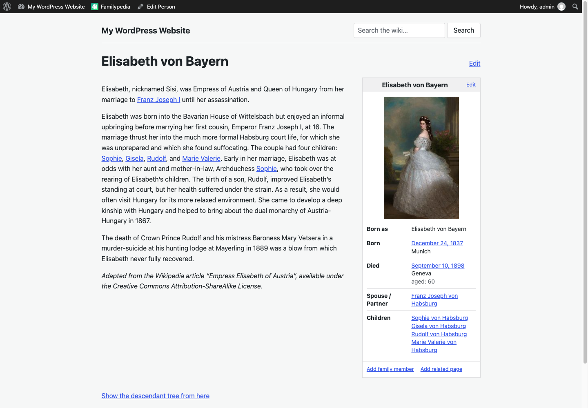
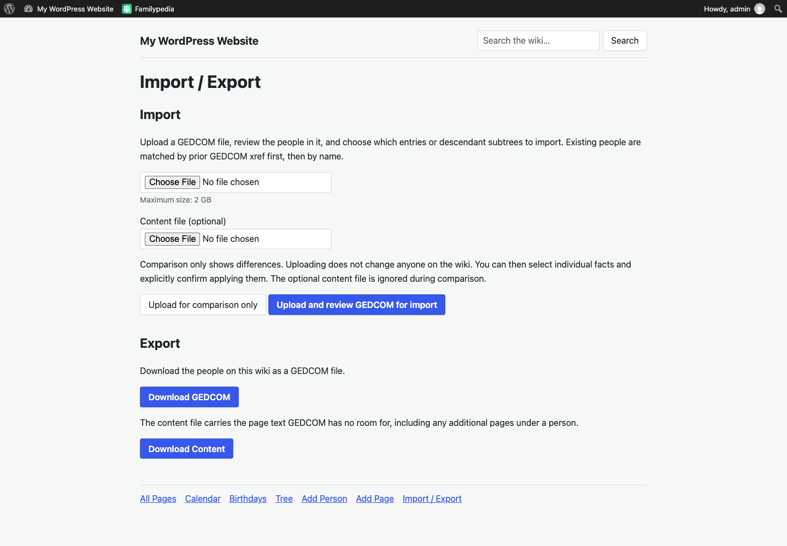
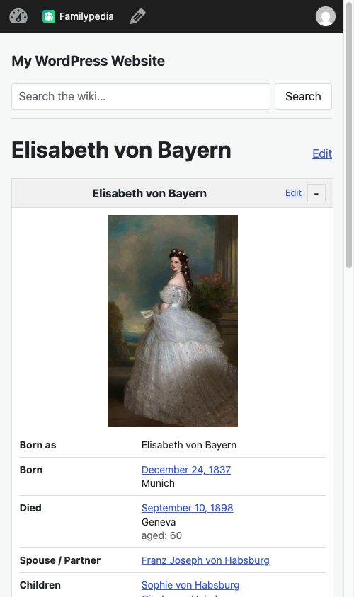

# Familypedia — Your private family wiki

- Contributors: akirk
- Tags: family, wiki, genealogy, wpapps
- Requires at least: 6.0
- Requires PHP: 7.4
- Tested up to: 7.1
- License: GPL-2.0-or-later
- License URI: https://www.gnu.org/licenses/gpl-2.0.html
- Stable tag: 2.0.0

Keep your family history in a private wiki app hosted on WordPress.

## Description

Familypedia brings the former Family Wiki plugin a dedicated interface, with people, stories, photos, family trees, calendars and GEDCOM import/export. Open the app at `/familypedia/`. It requires an Administrator or Editor account. Advanced Custom Fields is no longer required.

[Try the historical Habsburg family demo in WordPress Playground](https://playground.wordpress.net/?blueprint-url=https://raw.githubusercontent.com/akirk/family-wiki/main/demo.json).

On Import / Export, choose **Upload for comparison only** to review GEDCOM differences without changing the wiki. Each person has a comparison section. Edit the wiki value or use the copy arrow to carry over a GEDCOM value. Modified rows are checked automatically; review the individual name, sex, birth or death facts and press **Apply selected changes** to save. Missing facts never erase data; unmatched people, relationships and page text are left untouched. Facts edited since the comparison was opened are skipped.

Assign family contributors the standard WordPress Editor role to create, edit and delete wiki content and upload media. Administrators also manage settings. Other standard roles do not have wiki access. Editor permissions apply across the WordPress site, including deletion. Sites already using the legacy whole-site privacy setting (`blog_public = -1`) retain that protection and their selected option in Settings → Reading. Once displayed in Settings → Reading, its availability is remembered so administrators can disable and later re-enable it. The option is not offered on sites without legacy privacy. WpApp protects app content and its REST endpoints independently of whole-site visibility.

### Upgrading from Family Wiki 1.x

Back up your database, then open Tools → Upgrade Familypedia. Review and select your people and related pages. Pages with family facts are selected initially; include relatives and child pages together. Migration validates these dependencies before moving any posts.

Selected pages become app posts with the same IDs, content, featured images and hierarchy. Relationship IDs remain intact, ACF dates are normalized, settings are copied, and old person URLs redirect to the app. The original homepage remains a WordPress page; its content is also copied into the app homepage. Unselected ordinary site pages stay in WordPress. The migration can be run again for remaining pages.

Existing bio shortcodes and Family Wiki tree/calendar blocks continue to work. Existing ACF metadata is retained. Converting posts back to ordinary pages is not an automatic downgrade path; restore your backup to revert the migration.

### Optional member homepage

In Settings → Familypedia, enable “Show the wiki at the homepage for signed-in wiki members.” Authorized members then see the app homepage at `/`. Person pages and tools remain under `/familypedia/`. Anonymous visitors and accounts without wiki access keep the normal WordPress homepage, subject to the site's privacy setting. The option defaults off.

### Family interviews

Choose **Add → Interview** on a person's page to start a conversation or resume saved notes. Record the speaker and interview date, and choose whether they are describing their own life or someone else's. Topic chips let you browse optional question cards in any order. Selecting a card opens its follow-ups and an optional written-notes area; notes save automatically and can also be saved with the Save interview button. Without JavaScript, all questions appear together with expandable written notes and saving is manual.

Each interview is a separate draft related page containing the source notes. The fact review keeps the values recorded when the interview began, the speaker's account and any uncertainty. Applying a proposed fact is a separate action; year-only dates retain their approximate precision, and changed facts require review on the person's facts page.

Use **Customize questions** to edit your personal library and import or export JSON question sets. Untouched starter questions, topics and hints use WordPress translations; edited fields and custom questions keep your wording. Exports include the full topic, question and hint text, along with starter IDs where applicable. Importing an export preserves its wording, including unchanged starter text. Existing text-only libraries remain custom text. Saved interviews retain the wording used when they were started.

Record audio directly in an interview over HTTPS after allowing microphone access. Ask the speaker before recording. Pause/resume as needed, then stop, review, name and save the clip. Saved recordings can be renamed or permanently deleted (including the audio file) from the interview. The recorder floats at the bottom of the interview and continues across question changes. Switching questions automatically adds a timestamp (excluding paused time); the timeline is saved with the clip and its entries jump to that moment during playback. If saving fails, retry or download the local copy before closing the page. Clips stop automatically around 20 MB; server upload limits may be lower. External audio-file uploads and transcription are not included.

Recordings use standard WordPress Media Library attachments parented to their interview posts, with a cryptographically random 192-bit filename suffix. Anyone with a direct file URL can play or download the recording. WpApp versions supporting attachment access restrictions limit REST discovery through the parent app-owned post; this does not restrict direct file URLs. Back up recordings with the normal WordPress uploads directory and database. PHP Fileinfo is used to validate recording formats.

Select saved interviews to create an attributed biography outline. Edit and save the draft, then explicitly review it before adding its text after the existing biography. Interview sources remain linked and unchanged. This version collects typed notes and creates outlines without an external text-generation service.

### Development

Development happens on `main`. Dependencies in `vendor/` are ignored by Git; run `composer install --no-dev` before using a source checkout. For development checks, run `composer install` followed by `composer test`. The migration tests use an in-memory fixture and do not connect to WordPress or its database.

Every push to a source branch builds an installable `dist/<branch>` branch with production dependencies and appends the source commit to the plugin version. The build can also be run manually for a source branch from GitHub Actions. Use `dist/main` for installations and WordPress Playground; PR previews use their corresponding distribution branches and become available once the build finishes.

`demo.json` installs the app, signs in and imports the historical family from `demo/demo.ged`, adds the biography in `demo/demo-content.xml`, and places a descendant tree on the homepage. The seed data ships with the plugin so the gallery demo can also load it from a WordPress.org installation. The development-only generator can refresh the GEDCOM from Wikidata with `php demo/generate-demo-gedcom.php`; the XML includes its biography attribution and portrait source.

## Screenshots

1. The demo homepage with the Habsburg family tree and family highlights.
   
2. Elisabeth von Bayern’s biography, portrait, facts and family relationships.
   
3. The descendant tree rooted at Franz Karl von Habsburg.
   
4. The family calendar showing birthdays and anniversaries in December.
   
5. The alphabetical index of people in the demo family.
   
6. GEDCOM and content import/export tools.
   
7. A person’s page on mobile with the fact box expanded.
   

## Changelog

### 2.0.0
- Adopt the Familypedia app interface without an ACF dependency.
- Add reviewed migration of existing wiki pages, settings and legacy URLs.
- Add an optional wiki homepage for signed-in members.
- Preserve whole-site privacy, existing bio shortcodes and saved wiki blocks.

### 1.2.0
- Add automatic infoboxes with structured marriages data.
- Add cross-wiki settings, allowing infoboxes to link to the same person or page on peer wikis.
- Add a Family Wiki menu and virtual calendar pages.
- Add citizenships and cache family wiki data for performance.
- Add wedding anniversaries to the family calendar.
- Add a Family Tree block.
- Add GEDCOM import and export support, including a review step for large files.
- Add a content export/import alongside GEDCOM, carrying related child pages along with a person.
- Fix a cross-wiki privacy leak.

### 1.1.9
- Translated ACF fields to German.
- Lots of translation fixes.
- Fix translation loading to translate.wordpress.org.
- Redirect to the front page after logging in.
- Improve output escaping.

### 1.1.0
- Switch to using Advanced Custom Fields for metadata.

### 1.0.0
- Initial version
